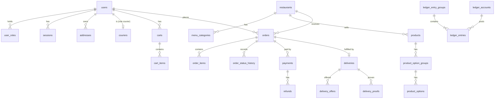

# Database and data model

The schema as it exists after applying all 29 migrations to PostgreSQL 16 + PostGIS on 2026-11-10,
what the database itself guarantees, and what it does not. The original design is in
`docs/06-schema-postgresql.md` (French); several tables designed there were never created.

## 1. How the schema is managed

- **The SQL migrations are the source of truth**: `apps/api/prisma/migrations/0001` → `0029`,
  hand-written, applied with `prisma migrate deploy` over a direct connection.
- **`schema.prisma` is a typed view of part of it**: 46 of the 52 application tables, no indexes,
  few relations, no PostGIS columns. Geography, ledger entries and `user_roles` are reached with
  raw SQL. Consequence: Prisma cannot detect drift; a column added in SQL and forgotten in the
  schema is silently invisible to typed code.
- The application connects through **PgBouncer in transaction-pooling mode**; the connection
  string needs `pgbouncer=true`.
- The worker uses the `pg` driver directly, with its own hand-written SQL.
- All 29 migrations applied cleanly on an empty database (verified). Migrations `0001`–`0028` were
  written before the schema had ever run on a real server; the first run, in October, required
  editing `0003` and adding `0029` (`docs/36`).

**Size:** 52 application tables · 96 foreign keys · 138 indexes · 47 check constraints · 19 triggers.

## 2. Tables by domain

| Domain         | Tables                                                                                                                                          | Notes                                                  |
| -------------- | ----------------------------------------------------------------------------------------------------------------------------------------------- | ------------------------------------------------------ |
| Platform       | `currencies`, `countries`, `cities`, `platform_settings`, `feature_flags`                                                                       | Reference data; settings read on every use, uncached   |
| Identity       | `users`, `roles`, `permissions`, `role_permissions`, `user_roles`, `sessions`, `otp_codes`, `phone_auth_locks`, `mfa_totp_secrets`, `addresses` | `user_roles` carries the restaurant scope              |
| Catalog        | `restaurants`, `menu_categories`, `products`, `product_option_groups`, `product_options`, `restaurant_hours`, `restaurant_closures`             | Full-text search columns on restaurants and products   |
| Commerce rules | `commission_rules`, `tax_rules`                                                                                                                 | `tax_rules` is empty and never read                    |
| Cart and order | `carts`, `cart_items`, `cart_item_options`, `orders`, `order_items`, `order_item_options`, `order_status_history`                               | Orders freeze prices, options and the delivery address |
| Payment        | `payment_methods`, `payment_providers`, `payment_provider_configs`, `payments`, `refunds`, `webhook_events`, `settlements`                      |                                                        |
| Ledger         | `ledger_accounts`, `ledger_entry_groups`, `ledger_entries`, `wallet_balances`                                                                   | Double entry; balances are a projection                |
| Delivery       | `couriers`, `deliveries`, `delivery_offers`, `delivery_proofs`                                                                                  | Geography columns for courier, pickup, drop-off        |
| Messaging      | `notifications`, `notification_devices`, `outbox`                                                                                               |                                                        |
| System         | `audit_logs`, `idempotency_keys`, `files`                                                                                                       | `files` is unused                                      |

## 3. What the database guarantees

These hold even if application code is wrong. Each was read in the migrations; those marked ✔ were
also exercised during the live run.

| Guarantee                                                                                     | Mechanism                                                       | Migration |
| --------------------------------------------------------------------------------------------- | --------------------------------------------------------------- | --------- |
| One live account per phone and per e-mail                                                     | Partial unique indexes on `users`                               | 0003      |
| One order per customer and idempotency key ✔                                                 | Unique `(customer_id, idempotency_key)`                         | 0010      |
| One payment per order and key; one **succeeded** payment per order                            | Unique + partial unique indexes                                 | 0010      |
| One open cart per user ✔                                                                     | Partial unique index                                            | 0019      |
| A cart has both a restaurant and a currency, or neither                                       | Check constraint                                                | 0019      |
| One default address per user                                                                  | Partial unique index                                            | 0027      |
| One active delivery per courier; one courier per active delivery; one live offer per delivery | Three partial unique indexes                                    | 0024      |
| A restaurant role is scoped to one restaurant per user                                        | Partial unique index                                            | 0028      |
| Refunds never exceed the payment                                                              | Trigger that locks the payment row and sums                     | 0021      |
| Ledger entries and groups cannot be changed or deleted ✔                                     | `forbid_mutation` triggers                                      | 0007      |
| Audit log cannot be changed or deleted                                                        | Same trigger                                                    | 0012      |
| A webhook event is processed once per provider and event id ✔                                | Unique `(provider_code, event_id)`                              | 0010      |
| One notification per user and source event                                                    | Unique `(user_id, dedup_key)`                                   | 0026      |
| Status vocabularies                                                                           | Enums for order and payment status; check constraints elsewhere | several   |
| `updated_at` maintained                                                                       | Triggers on mutable tables                                      | several   |

This is a strong set. The delivery and refund invariants in particular were added after earlier
reviews found the application-only versions could race.

## 4. What the database does not guarantee

| Gap                                                                                                                                        | Evidence                                                                                                                        | Finding                          |
| ------------------------------------------------------------------------------------------------------------------------------------------ | ------------------------------------------------------------------------------------------------------------------------------- | -------------------------------- |
| **Who may write the ledger.** The application's role owns the tables, so the `REVOKE … FROM PUBLIC` in migration 0007 does not restrict it | LIVE: a direct, unbalanced insert into `ledger_entries` and a direct insert into `wallet_balances` succeeded without `SET ROLE` | [`SEC-07`](FINDINGS.md#sec-07)   |
| **That an entry group balances.** Checked in TypeScript before insert, and by an hourly job that only logs                                 | CODE                                                                                                                            | [`SEC-07`](FINDINGS.md#sec-07)   |
| **That balances stay non-negative**                                                                                                        | No check on `wallet_balances`                                                                                                   | [`DB-01`](FINDINGS.md#db-01)     |
| **That a paid order is ever placed, or a ready order ever gets a delivery**                                                                | These are cross-table reactions done in application memory                                                                      | [`ARCH-01`](FINDINGS.md#arch-01) |
| **That an order meets the restaurant's minimum**                                                                                           | `restaurants.min_order_minor` is stored and displayed only                                                                      | [`ORD-03`](FINDINGS.md#ord-03)   |
| **A primary key on `user_roles`**                                                                                                          | Unique expression index instead                                                                                                 | [`DB-01`](FINDINGS.md#db-01)     |

## 5. Type pitfall that already caused a defect

`SUM()` over a `bigint` column returns `numeric` in PostgreSQL, which Prisma delivers as a
`Decimal` object, not a JavaScript `bigint`. Arithmetic mixing the two throws. `ledger-read.service.ts`
casts its sums to `::bigint`; `payments.service.ts` does not, and every refund crashes
([`PAY-03`](FINDINGS.md#pay-03)). **Rule: every aggregate over a money column must end in `::bigint`.**
The in-memory test fakes return `bigint` and so cannot catch this.

## 6. Tables designed but not created

Present in `docs/06` and absent from the migrations: delivery zones (yet
`payment_provider_configs.delivery_zone_id` exists with nothing to reference), payouts, wallet
transactions, disputes, reviews, promotions and coupons, favourites, courier documents and
location history, support tickets. Each corresponds to a feature that does not exist yet.

## 7. Tables that exist but are not really used

After the complete live run, these held no rows written by application code:

| Table                  | Why                                                                                          |
| ---------------------- | -------------------------------------------------------------------------------------------- |
| `files`                | No upload path ([`STOR-01`](FINDINGS.md#stor-01))                                            |
| `tax_rules`            | Never read by pricing ([`ORD-05`](FINDINGS.md#ord-05))                                       |
| `refunds`              | The endpoint crashes before inserting ([`PAY-03`](FINDINGS.md#pay-03))                       |
| `settlements`          | Reachable only by roles that cannot step up ([`ADM-01`](FINDINGS.md#adm-01)) — not exercised |
| `notification_devices` | No client registers a device ([`NOTIF-01`](FINDINGS.md#notif-01))                            |

## 8. Growth and retention

Nothing deletes or archives rows. Tables that grow with every request or event: `otp_codes`,
`sessions` (one row per token rotation), `idempotency_keys`, `outbox`, `webhook_events`,
`audit_logs`, `notifications`, `order_status_history`, `delivery_offers`. At the target volume this
is months away from mattering, but `idempotency_keys` and `sessions` should have a retention job
before launch ([`WRK-01`](FINDINGS.md#wrk-01)).

## 9. Query efficiency

Not load-tested. From reading the queries:

- Hot paths are indexed: orders by customer and by restaurant/status, deliveries by status,
  couriers by status with a spatial index, outbox by status and due time.
- **Ledger account lookup** (`ledger.repository.ts`) matches on an expression
  (`code || ':' || owner_id`) that no index can serve; it scans `ledger_accounts`, which gains two
  to five rows per restaurant and courier. Fine now; rewrite before scale.
- **Platform settings** are read from the database on every use — about five queries per dispatch
  wave and three per OTP request. A short in-memory cache would remove them.
- About fifty foreign keys have no supporting index. Most reference `currencies` and do not matter.
  Worth indexing: `orders.dropoff_address_id` (deleting an address scans orders),
  `order_items.product_id`, `cart_items.product_id`, `sessions.parent_id`.
- List endpoints use offset pagination with a separate `count(*)`; acceptable at this size.

## 10. Seed data

`apps/api/prisma/seed.ts` (879 lines) creates, in one run: currencies, the launch country and city,
roles, permissions and their mapping, platform settings, payment methods and providers, a 20 %
country-level commission rule, the chart of accounts — **and** eight test users for every role,
five test restaurants with menus, a test courier with a position, and an address. It is idempotent.
It must be split before any shared environment exists ([`SEC-02`](FINDINGS.md#sec-02)).

## 11. Backup and recovery

Nothing exists: no backup job, no restore procedure, no point-in-time recovery configuration
([`OPS-02`](FINDINGS.md#ops-02)). The ledger's append-only design makes logical corruption
detectable but not recoverable without backups.

Last updated: 2026-11-11 (evidence collected 2026-11-10)
