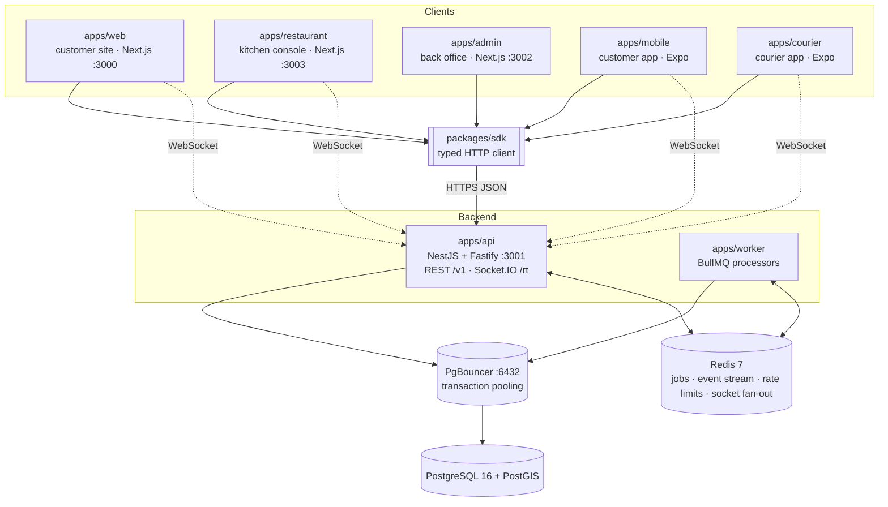
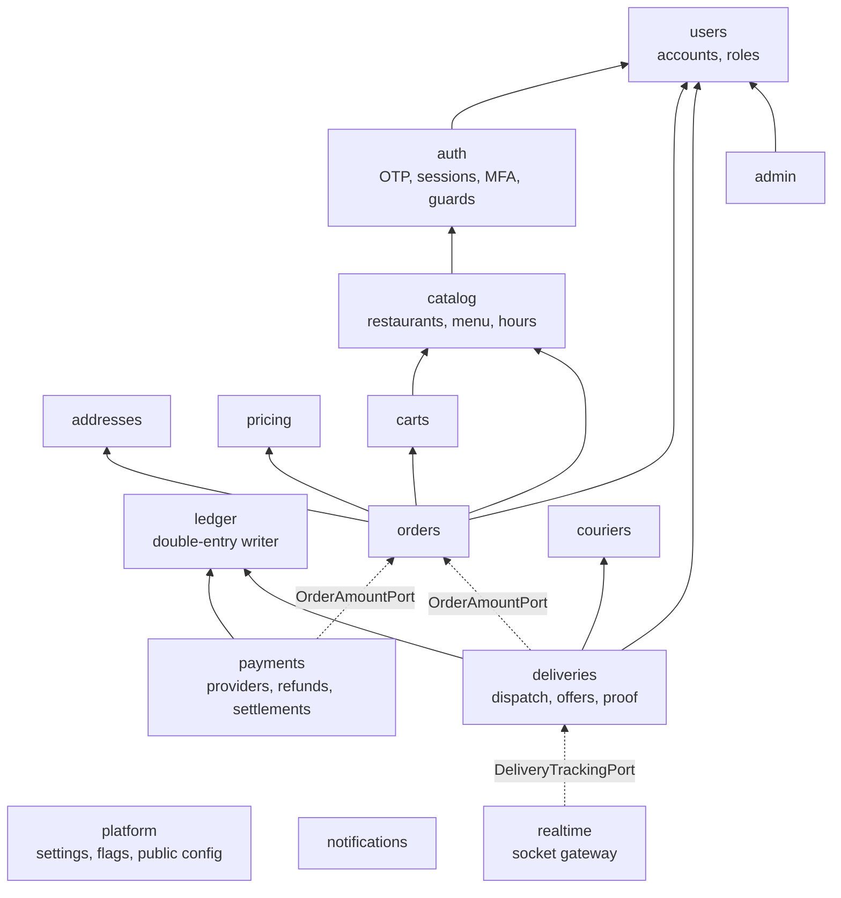
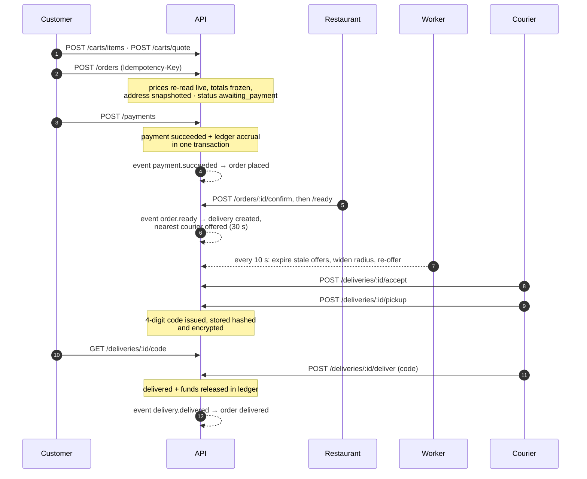
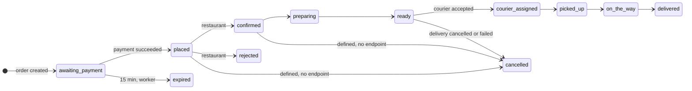
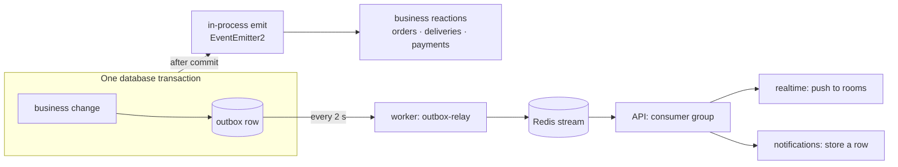

# System architecture

How DJAFAT is put together as it exists on `main`. The reasoning behind the design is in the French
dossier (`docs/01`, `docs/05`, `docs/08`, `docs/09`); this page describes what the code does.

## 1. Components

- **One backend process** serves REST and realtime; **one worker process** runs scheduled jobs.
  Both are stateless apart from socket connections.
- Web pages that show the catalog are **rendered on the server** and call the API from Node.
  Everything behind login is rendered in the browser and calls the API through the SDK.
- The local Compose file also starts MinIO, Mailpit, a mock payment server and a mock SMS server.
  **No application code talks to any of them** (the mock payment and OTP providers run inside the
  API process). Only PostgreSQL, PgBouncer and Redis are required.

## 2. Backend modules

`apps/api/src` is a modular monolith. Modules may depend only "downwards"; the rule is enforced by
`eslint-plugin-boundaries` (`packages/eslint-config/api-boundaries.js`).

Dotted lines are **ports**: an interface declared in `common/ports`, implemented by one module and
injected into another by token, so the dependent module never imports the other's code.
`geo` is an empty skeleton. For readability the diagram omits two edges that almost every module
has: `auth` (for the guards) and `platform` (for settings).

Cross-cutting pieces live in `common/` (configuration, error envelope, idempotency, audit log, rate
limiter, authorisation helpers, health) and `infra/` (Prisma, outbox, object-storage stub).

## 3. How a request is handled

1. Fastify assigns a request ID; pino logs the request with secrets redacted.
2. Route decorators attach guards: `@RequireAuth`, `@RequireRole`, `@RequirePermission`,
   `@RequireOwnership`, `@RequireStepUp`. **There is no global guard: a route with no decorator is
   public.** Thirteen routes are public by design (health, readiness, public config, payment-method
   discovery, the five catalog reads, OTP request and verify, refresh, payment webhook).
3. The actor is resolved from the bearer token (signature, expiry, issuer, audience), then account
   status and permissions are read from the database on every request. Roles come from the token.
4. Bodies and queries are validated by Zod schemas, mostly from `@djafat/validation`.
5. Writes that must not repeat take an `Idempotency-Key` header and go through
   `IdempotencyService` (a row in `idempotency_keys`; replays return the stored response).
6. Any error becomes `{ "error": { "code", "message", "traceId", "details?" } }`.

## 4. The order lifecycle

Steps 4 and 9–11 are the ones no customer application can perform today
([`FE-01`](FINDINGS.md#fe-01), [`FE-03`](FINDINGS.md#fe-03)).

### State machines

Defined once in `packages/core` and reused by API and tests.

**Delivery:** `pending → searching_courier → courier_assigned (offered) → courier_accepted →
pickup_in_progress → picked_up → on_the_way → delivered`, with `cancelled` and `failed` as exits.
**Payment:** `pending → succeeded | failed | cancelled | expired | needs_review`, then
`partially_refunded | refunded`.

## 5. Events: two channels with different guarantees

This is the most important structural fact about the backend.

|             | In-process channel                                                                           | Durable channel                      |
| ----------- | -------------------------------------------------------------------------------------------- | ------------------------------------ |
| Carries     | `payment.succeeded`, `order.ready`, `delivery.accepted/picked_up/delivered/cancelled/failed` | every outbox event                   |
| Consumed by | the modules that **change business state**                                                   | realtime and notifications only      |
| Guarantee   | at most once; lost on crash or handler error                                                 | at least once; retried, acknowledged |

So the reactions that matter most — placing a paid order, creating the delivery, closing the order,
settling a cash payment — ride on the channel that can lose messages, and nothing repairs a miss.
See [`ARCH-01`](FINDINGS.md#arch-01).

## 6. Money

All amounts are integers in minor units. Every movement is a balanced group of ledger entries
posted by `LedgerService`; restaurant and courier balances (`wallet_balances`) are projections
updated in the same transaction.

| When                     | Ledger group      | Entries (debit → credit)                                                                                                             |
| ------------------------ | ----------------- | ------------------------------------------------------------------------------------------------------------------------------------ |
| Prepaid payment succeeds | `order_accrual`   | provider clearing + provider fee expense → restaurant payable (subtotal − commission), courier fee pool, DJAFAT revenue (commission) |
| Courier accepts          | `adjustment`      | courier fee pool → that courier's payable                                                                                            |
| Delivered                | `funds_available` | restaurant payable → restaurant available; courier payable → courier available                                                       |
| Refund                   | `refund`          | DJAFAT revenue → provider clearing (or refunds payable for cash)                                                                     |
| Settlement recorded      | `settlement`      | DJAFAT bank → provider clearing                                                                                                      |

Verified on a 12 000 XAF order: provider fee 180, restaurant 8 800, courier 1 000, commission
2 200; all groups balanced. What is missing around this core: reversal on failure, payouts, the
cash path, and a working refund — see [`modules/PAYMENTS_AND_LEDGER.md`](modules/PAYMENTS_AND_LEDGER.md).

## 7. Dispatch

When an order becomes `ready`, a delivery is created with the restaurant's coordinates. A wave
looks for couriers who are online, free, located within the last 120 seconds and within a radius
that starts at 3 km and widens by 2 km per empty wave up to 8 km; the nearest is offered the
delivery for 30 seconds. Offers go to one courier at a time. Database partial unique indexes
guarantee one active delivery per courier and one live offer per delivery. The worker re-runs
waves every 10 seconds with its own copy of the same SQL ([`ARCH-02`](FINDINGS.md#arch-02)).

## 8. Realtime

Clients connect to `/rt` with their access token, then `subscribe` to a room: `order:{id}`,
`courier:{id}`, `restaurant:orders:{id}` or `admin:ops`. The gateway checks the right to join each
room. Events carry only identifiers and a status — a hint to refetch over REST, never the data.
A Redis adapter is attached for several instances (not proven with more than one).

## 9. What is not there

No API gateway or reverse proxy configuration, no CDN, no object storage adapter, no email, no SMS
or push provider, no payment provider other than cash and a test double, no geocoding or maps, no
search engine (PostgreSQL full-text search is used), no deployment definition.

Last updated: 2026-11-11 (evidence collected 2026-11-10)
