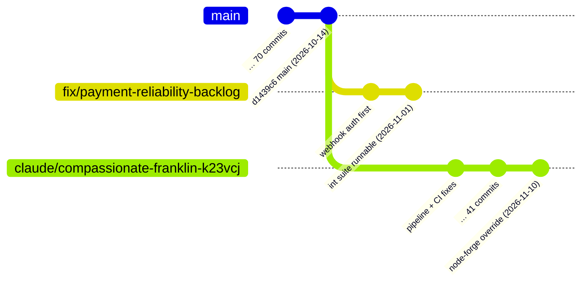

# Unmerged branches

`main` is not where development is happening. Two remote branches are ahead of it, and they do not
contain each other. This page records what they hold and how they relate to the audit, so that
nobody fixes on `main` what already exists elsewhere — or assumes something is fixed that is not.

**How this was established:** `git` only (`log`, `diff --stat`, `ls-tree`, `show`). **Neither
branch was checked out, built, or run.** Everything below about their content is evidence level
BRANCH: read, not verified. Finding: [`GOV-01`](FINDINGS.md#gov-01). Task: T-001.

## 1. The three lines

| Branch                                        | Ahead of `main` | Last commit      | Author                  | Size                      |
| --------------------------------------------- | --------------- | ---------------- | ----------------------- | ------------------------- |
| `main`                                        | —               | 2026-10-14       | repository owner        | —                         |
| `origin/fix/payment-reliability-backlog`      | 2 commits       | 2026-11-01       | repository owner        | 14 files, +1 514 / −135   |
| `origin/claude/compassionate-franklin-k23vcj` | 41 commits      | 2026-11-10 18:10 | Claude (agent sessions) | 456 files, +31 592 / −527 |

_(Updated 2026-11-11, sync S-001: the larger branch moved from `2a622a1` to `804176f`, four commits —
see §3.4.)_

Both start from `main`'s head, so each could fast-forward `main` alone. They touch overlapping
files (`payments.service.ts`, the integration test configuration, the lockfile, CI), so merging
both will need conflict resolution.

_(updated 2026-11-12, sync S-004)_ Two branches of ours are also open against `main`:
`docs/audit-sync` (pull request #2: this documentation and the gitleaks token) and `fix/next-15.5`
(pull request #3, §2b).

## 2. `fix/payment-reliability-backlog` (2 commits)

| Commit                                                                             | What it does                                                                            | Audit finding                              |
| ---------------------------------------------------------------------------------- | --------------------------------------------------------------------------------------- | ------------------------------------------ |
| `6cf7c9b` fix(payments): authenticate webhooks before idempotency reservation      | Moves the signature check ahead of the insert into `webhook_events`                     | Fixes [`PAY-05`](FINDINGS.md#pay-05)       |
| `a68934d` fix(ci): make the integration suite actually runnable, in CI and locally | Test set-up file, new Vitest configuration, rewritten walking-skeleton test, CI secrets | Addresses [`TEST-01`](FINDINGS.md#test-01) |

**The webhook fix exists only here.** The larger branch still inserts before verifying.

`a68934d` also gives the integration job two throwaway base64 keys (`MFA_ENCRYPTION_KEY`,
`DELIVERY_CODE_ENCRYPTION_KEY`), labelled as such in the file. The weekly gitleaks scan flags both,
so they need an allowlist entry ([`CI-01`](FINDINGS.md#ci-01)) _(updated 2026-11-11, sync S-003)_.

## 2b. `fix/next-15.5`, pull request #3 (4 commits) _(added 2026-11-12, sync S-004; updated sync S-005)_

Our own branch, from `main` `d1439c6`, made at the user's request.

| Commit                                                                      | What it does                                                                                                                       | Audit finding                                                           |
| --------------------------------------------------------------------------- | ---------------------------------------------------------------------------------------------------------------------------------- | ----------------------------------------------------------------------- |
| `5d36c6a` fix(web,admin,restaurant): upgrade next from 15.1.3 to 15.5.29    | `next` 15.5.29 in the three web apps and `packages/ui`; lockfile; `typedRoutes` out of `experimental`; regenerated `next-env.d.ts` | Fixes the `next` part of [`DEP-01`](FINDINGS.md#dep-01), verified there |
| `480ec14` fix(ci): give gitleaks-action the token it needs on pull requests | The same lines as pull requests #1 and #2                                                                                          | Part of [`CI-01`](FINDINGS.md#ci-01)                                    |
| `c616695` fix(mobile): let Metro find each package's own dependencies       | Metro's hierarchical lookup back on in both Expo apps; the same lines as pull request #1's `a972a35`                               | Fixes [`MOB-01`](FINDINGS.md#mob-01) on the branch (CI build passes)    |
| `6cbbad4` fix(ci): build the API's workspace packages before seeding        | One CI step, the same as pull request #1's                                                                                         | Part of [`CI-01`](FINDINGS.md#ci-01): `integration` gets past Seed      |

Merging (tested with `git merge-tree`): clean with `main` and `docs/audit-sync`. With
`claude/compassionate-franklin-k23vcj`: conflicts in `apps/web/package.json` (keep `leaflet` from
there and `next` 15.5.29 from here) and in `pnpm-lock.yaml` (take either side, then run
`pnpm install`). With `fix/payment-reliability-backlog`: `pnpm-lock.yaml` only.

_(updated 2026-11-12, sync S-005)_ `c616695` and `6cbbad4` were pushed by another Claude session
working as the repository's user. Since `6cbbad4`, `.github/workflows/ci.yml` conflicts with pull
request #1 as well: both add the same build step, and pull request #1 adds a throwaway-secrets step
next to it, so take pull request #1's version.

## 3. `claude/compassionate-franklin-k23vcj` (41 commits)

### What it adds

| Area           | Content (from commit messages and file lists)                                                                                                                                                                                                                                                          |
| -------------- | ------------------------------------------------------------------------------------------------------------------------------------------------------------------------------------------------------------------------------------------------------------------------------------------------------ |
| Process        | A "spec-driven agentic pipeline": `CLAUDE.md`, `.claude/agents`, eleven `.claude/skills`, `scripts/pipeline` (20 files), `docs/pipeline` (6 files), `docs/features/FEAT-001…018` (165 files), commands `pnpm verify` and `verify:fast`                                                                 |
| CI and tests   | Secrets for the integration job; workspace build before seeding; SWC transform for integration tests; gitleaks token and permissions; advisory gating                                                                                                                                                  |
| Authentication | Phone numbers accepted as typed in Chad; real SMS gateway and refusal to boot in production without one; e-mail login; WhatsApp codes; a registry of login methods; server-side logout from every app                                                                                                  |
| Payments       | Test provider barred from production; cash orders placed instead of expiring; mobile-money transfers to a merchant number matched by transaction number; pay a cash order by mobile money at the door; cash allowed within a customer trust score; reading operator SMS forwarded from merchant phones |
| Couriers       | Cash ceiling and remittances; earnings, history and payouts; courier app runnable in a phone browser; fix for a busy courier losing an offer                                                                                                                                                           |
| Customer       | Payment step; larger order tracker; live delivery map; profile page; ordering without data via WhatsApp/SMS; landmarks and learned delivery points; voice notes                                                                                                                                        |
| Admin          | Taking phone orders for callers, paid by mobile money, with the delivery code given by voice                                                                                                                                                                                                           |
| SDK            | `fetch` binding fix; `auth.ts`, `payments.ts`, `payouts.ts`                                                                                                                                                                                                                                            |
| Mobile         | "bundle the customer and courier apps again"                                                                                                                                                                                                                                                           |
| Infrastructure | One-server production stack: `docker-compose.prod.yml`, Caddy, backup script, secret generation, a Dockerfile for the Next apps                                                                                                                                                                        |
| Database       | Eight more migrations, `0030` → `0037`                                                                                                                                                                                                                                                                 |

### How it relates to the audit's findings

Checked by reading the specific files on the branch.

| Finding                                                           | On this branch               | Basis                                                                                                                                                        |
| ----------------------------------------------------------------- | ---------------------------- | ------------------------------------------------------------------------------------------------------------------------------------------------------------ |
| [`SDK-01`](FINDINGS.md#sdk-01) Browser `fetch`                    | **Fixed**                    | `http.ts`: `this.doFetch = (input, init) => impl(input, init)`; a regression test file exists                                                                |
| [`TEST-01`](FINDINGS.md#test-01) Integration suite                | **Addressed**                | Vitest configuration imports `unplugin-swc`; since S-001 the suite also resets limiter keys and the fixture hours before each test; the branch reports 92/93 |
| [`FE-01`](FINDINGS.md#fe-01) No payment step                      | **Addressed**                | SDK `payments.ts`; commit "payment step…"                                                                                                                    |
| [`FE-02`](FINDINGS.md#fe-02) No token refresh                     | **Partly**                   | SDK `auth.ts` calls `auth/refresh`; per-app adoption not checked                                                                                             |
| [`PAY-02`](FINDINGS.md#pay-02) Cash never placed                  | **Addressed**                | Commit `424ff32`; code not inspected                                                                                                                         |
| [`AUTH-01`](FINDINGS.md#auth-01) No OTP delivery                  | **Addressed**                | Commits `8a2f0d0`, `bd7a885`; needs a provider account to verify                                                                                             |
| [`PAY-01`](FINDINGS.md#pay-01) Enablement not enforced            | **Partly at most**           | A production lock for the test provider (commit `a09d14a`); a general enablement check at payment creation was not found                                     |
| [`MOB-01`](FINDINGS.md#mob-01) Expo bundling                      | **Claimed**                  | Commit `a972a35`; not verified                                                                                                                               |
| [`OPS-02`](FINDINGS.md#ops-02) No deployment                      | **Addressed for one server** | `infra/deploy/*`, plus `install.sh` since S-001; live mode lacks reference data ([`OPS-05`](FINDINGS.md#ops-05))                                             |
| [`FE-04`](FINDINGS.md#fe-04) Profile and history                  | **Profile only**             | Route `profil` added; still no `commandes` index                                                                                                             |
| [`PAY-03`](FINDINGS.md#pay-03) Refund crash                       | **Still present**            | Both `SUM(amount_minor)` queries unchanged, no cast                                                                                                          |
| [`PAY-05`](FINDINGS.md#pay-05) Webhook order                      | **Still present**            | Insert precedes the signature check                                                                                                                          |
| [`ORD-03`](FINDINGS.md#ord-03) Minimum order                      | **Still present**            | No enforcement found in carts or orders                                                                                                                      |
| [`ORD-01`](FINDINGS.md#ord-01) Order cancellation                 | **Still present**            | Same seven order routes                                                                                                                                      |
| [`DEP-01`](FINDINGS.md#dep-01) Vulnerable dependencies            | **Still present**            | `next` 15.1.3, `fastify` 4.29.0, Nest 10.4.15 unchanged; only `node-forge` forced to 1.4.3 (S-001)                                                           |
| [`OPS-01`](FINDINGS.md#ops-01) `infra:up`                         | **Still present**            | Same MinIO and PostGIS images in the development compose; only the production stack handles ARM (S-001)                                                      |
| [`OPS-05`](FINDINGS.md#ops-05) Live server without reference data | **New on this branch**       | Found in sync S-001                                                                                                                                          |
| Everything else                                                   | **Not checked**              | Assume open until verified                                                                                                                                   |

### Risks specific to this branch

- **Volume and pace.** Forty-one commits and about 31 600 lines in five days, across authentication,
  payments, cash handling and payouts — the areas where `main` already has its most serious
  defects. None of it has been reviewed against a running system by this audit.
- **Built on the defects found here.** Payouts and cash control were added on a ledger whose
  refund path crashes and whose failure paths do not reverse money.
- **Its own governance documents.** The branch tracks features in `docs/features/FEAT-nnn`, has a
  `CLAUDE.md`, and since S-001 a reference roadmap, `docs/ROADMAP.md`, updated on every push with a
  version number. This documentation's `PROJECT_STATUS.md` and those documents must be reconciled
  after the merge (see §5).
- **Status claims not backed by a run of the product.** `docs/ROADMAP.md` marks the pilot functions
  "faites et vérifiées en vrai". On `main` the same journey fails in a browser; on the branch this
  audit has not run anything. Treat the claim as unverified until a person completes the journey in
  the applications.
- **The two remote branches conflict** in 6 files (S-001, tested in a throwaway clone), among them
  `payments.service.ts` and the lockfile.
- **A green audit job does not mean no critical vulnerability.** The advisory baseline
  (`scripts/pipeline/baselines/audit.json`) accepts all eight critical advisories, including five
  in `next` (four of them remote code execution), although its stated reason names only Expo and
  React Native ([`DEP-01`](FINDINGS.md#dep-01)) _(updated 2026-11-11, sync S-003)_.

### 3.4 Since the audit — sync S-001 (2026-11-11)

Four commits pushed on 2026-11-10 between 10:31 and 18:10, author "Claude". Full review in
[`history/SYNC_LOG.md`](history/SYNC_LOG.md).

| Commit    | What it does                                                                                                                                                        | Effect on the findings                                     |
| --------- | ------------------------------------------------------------------------------------------------------------------------------------------------------------------- | ---------------------------------------------------------- |
| `ef13704` | Integration tests reset the OTP limiter keys and open the fixture restaurant all day before each test                                                               | `TEST-01`: further addressed on the branch (92/93 claimed) |
| `41296a8` | `docs/ROADMAP.md` (versioned team roadmap), `docs/TRAVAILLER-EN-LOCAL.md` (local setup), versioning rule in `CLAUDE.md`, ARM PostGIS choice in the production stack | `DOC-02` (status claims), `OPS-01` (production only)       |
| `54d50b5` | `infra/deploy/install.sh`: one-command install on a single server                                                                                                   | `OPS-02` partly addressed; new `OPS-05`                    |
| `804176f` | Forces `node-forge` to 1.4.3; root `package.json` version `0.19.2`                                                                                                  | `DEP-01` partly addressed                                  |

Evidence: BRANCH — read, not run.

_(updated 2026-11-11, sync S-003)_ Pull request #2 (`docs/audit-sync`) carries this branch's
`gitleaks` job lines unchanged (`281c323`). Merged together, `security.yml` comes out as this
branch's file, and the only conflict between the two pull requests is `.claude/settings.json`
(merge test RUN). Hosted checks of this branch's pull request #1 (head `804176f`): `check`,
`gitleaks` and `pnpm audit` pass; `integration` fails.

## 4. Options

| Option                                                                                                                     | For                                                               | Against                                                                                             |
| -------------------------------------------------------------------------------------------------------------------------- | ----------------------------------------------------------------- | --------------------------------------------------------------------------------------------------- |
| **A. Merge the large branch into `main`, then apply the fix branch on top**                                                | Brings every existing fix at once; one line of history; no rework | A very large unreviewed change becomes the baseline; this audit must be partly redone on the result |
| **B. Cherry-pick the fixes** (SDK, integration suite, CI, webhook, Expo) onto `main`; review features in groups afterwards | `main` becomes usable and testable quickly; features get reviewed | Conflicts; the feature work keeps diverging while it waits                                          |
| **C. Leave `main`; make the large branch the working line**                                                                | No merge work                                                     | `main` stays broken; the default branch misleads everyone, as it did here                           |

**Recommendation: B first, then A in reviewed slices.** Start with the commits that make
verification possible — SDK binding, runnable integration tests, CI repairs, webhook ordering —
then bring features in the order the roadmap needs them, each verified against a real database and
a real browser before it lands. Whatever is chosen, do it before starting any Phase 1 task.

## 5. After the merge

- Re-run the checks in [`TESTING_AND_QUALITY_ASSURANCE.md`](TESTING_AND_QUALITY_ASSURANCE.md) on the
  merged code and update every finding's status with real evidence.
- Decide how `docs/features/FEAT-nnn` and this folder's `tasks/` relate. Suggested: features keep
  their specifications there; `PROJECT_STATUS.md` stays the one status page and links to them.
- Decide how `docs/ROADMAP.md` and `docs_2/PROJECT_STATUS.md` divide the work. Suggested, so the two
  do not contradict each other: the roadmap holds the **plan** — phases, decisions, versions, in
  French, for the whole team; the status page holds the **verified state** — what works, with the
  evidence. The roadmap's ticks then link to the findings or tasks that prove them.
- Add the 18 features to [`APPLICATION_INVENTORY.md`](APPLICATION_INVENTORY.md) and the module
  documents as "Needs Verification" until each is exercised.
- Delete merged branches.

Last updated: 2026-11-11 (sync S-001)
