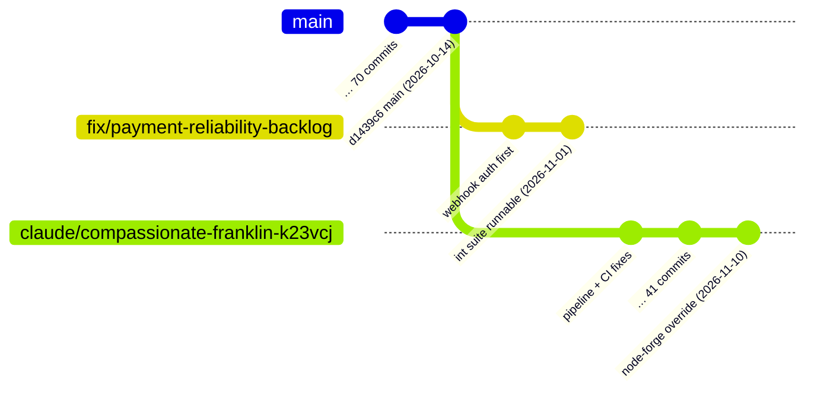

# Unmerged branches

`main` is not where development is happening. Two remote branches are ahead of it, and they do not
contain each other. This page records what they hold and how they relate to the audit, so that
nobody fixes on `main` what already exists elsewhere — or assumes something is fixed that is not.

**How this was established:** `git` only (`log`, `diff --stat`, `ls-tree`, `show`). **Neither
branch was checked out, built, or run.** Everything below about their content is evidence level
BRANCH: read, not verified. Finding: [`GOV-01`](FINDINGS.md#gov-01). Task: T-001.

## 1. The three lines

| Branch                                        | Ahead of `main` | Last commit      | Author                  | Size                      |
| --------------------------------------------- | --------------- | ---------------- | ----------------------- | ------------------------- |
| `main`                                        | —               | 2026-10-14       | repository owner        | —                         |
| `origin/fix/payment-reliability-backlog`      | 2 commits       | 2026-11-01       | repository owner        | 14 files, +1 514 / −135   |
| `origin/claude/compassionate-franklin-k23vcj` | 41 commits      | 2026-11-10 18:10 | Claude (agent sessions) | 456 files, +31 592 / −527 |

_(Updated 2026-11-11, sync S-001: the larger branch moved from `2a622a1` to `804176f`, four commits —
see §3.4.)_

Both start from `main`'s head, so each could fast-forward `main` alone. They touch overlapping
files (`payments.service.ts`, the integration test configuration, the lockfile, CI), so merging
both will need conflict resolution.

_(updated 2026-11-12, sync S-004)_ Two branches of ours are also open against `main`:
`docs/audit-sync` (pull request #2: this documentation and the gitleaks token) and `fix/next-15.5`
(pull request #3, §2b).

_(updated 2026-11-14, sync S-007)_ `claude/compassionate-franklin-k23vcj` is merged into `main`
(pull request #1, `46d8cae`, DJAFAT 0.20.1), and the collaborator's guides now name `main` as the
reference branch. Our pull requests #2 and #3 and the branch `fix/audit-blockers` are stacked on
it, to be merged in that order.

_(updated 2026-11-14, sync S-008)_ The stack: #2 `docs/audit-sync` (0.20.2) → #3 `fix/next-15.5` (0.20.3, `69cd859`)
→ #4 `fix/audit-blockers` (0.20.4 to 0.20.6, `aa0d58d`: `PAY-03`, `FE-03`, `SEC-01`). The merges
`6b13d96` (`main` and #2 into #3) and `ab92c1a` (#3 into #4) add nothing of their own: their
combined diff is empty. Merge #2, then #3, then #4; each one only after its Linux and Windows
checks are green.

_(updated 2026-11-17, sync S-009)_ `main` moved to `9058e33` (0.20.3) with pull requests #5 and #6. The stack now
conflicts with it on `package.json` and `docs/ROADMAP.md`, because `main` used 0.20.2 and
0.20.3 too: bring `main` into #2 first, then renumber the stack from 0.20.4.
`fix/browser-fetch-and-local-dev` (#5) was deleted after its merge.

_(updated 2026-11-17, sync S-010)_ Done: `main` merged into #2 (`c1abcba`), version 0.20.4 (`d366f12`); #2 into #3
(`0c61784`), 0.20.5 (`c715ae2`); #3 into #4 (`7452ec4`, its three versions renumbered 0.20.6 to
0.20.8, same commits), then `PAY-05` as 0.20.9 (`2319186`). Merge order unchanged: #2, #3, #4.

_(updated 2026-11-17, sync S-011)_ #4 gains `PAY-01` as 0.20.10 (`a017f48`): it now holds all five blocking fixes
(`PAY-03`, `FE-03`, `SEC-01`, `PAY-05`, `PAY-01`).

_(updated 2026-11-17, sync S-012)_ New branch `fix/api-nest11-fastify5`, stacked on #4: `862ad24` (0.20.11) moves the API
to NestJS 11 and Fastify 5, bounds Prisma's disconnect on shutdown, and trims the audit baseline. Merge
it after #4.

_(updated 2026-11-17, sync S-013)_ **The stack is merged.** #2 (`05ecacc`), #3 (`f9a8f41`), #4 (`44ae073`) and #7 (`75db772`)
went into `main` in that order, each with every check green, and their branches were deleted.
Left on GitHub: `claude/compassionate-franklin-k23vcj` (at `9058e33`, already in `main`) and the
owner's `fix/payment-reliability-backlog` (§2).

_(updated 2026-11-17, sync S-014)_ New: the owner's `feat/welcome-greeting` (§2c).

_(updated 2026-11-18, sync S-031)_ Ten pull requests of ours are open, #13 to #22, stacked in that
order; none is merged yet (§2d).

_(updated 2026-11-18, sync S-032)_ #13 to #16 are merged into `main` (`034123a`); #17 to #23 remain (§2d).

_(updated 2026-11-18, sync S-033)_ New: `fix/live-bootstrap` (#24, 0.23.4), stacked on #23 (§2d).

_(updated 2026-11-18, sync S-034)_ All of #13 to #24 are merged into `main` (`afaa7c2`, DJAFAT 0.23.4). Left on GitHub:
`claude/compassionate-franklin-k23vcj` (already in `main`) and the owner's `fix/payment-reliability-backlog`.

## 2. `fix/payment-reliability-backlog` (2 commits)

| Commit                                                                             | What it does                                                                            | Audit finding                              |
| ---------------------------------------------------------------------------------- | --------------------------------------------------------------------------------------- | ------------------------------------------ |
| `6cf7c9b` fix(payments): authenticate webhooks before idempotency reservation      | Moves the signature check ahead of the insert into `webhook_events`                     | Fixes [`PAY-05`](FINDINGS.md#pay-05)       |
| `a68934d` fix(ci): make the integration suite actually runnable, in CI and locally | Test set-up file, new Vitest configuration, rewritten walking-skeleton test, CI secrets | Addresses [`TEST-01`](FINDINGS.md#test-01) |

**The webhook fix exists only here.** The larger branch still inserts before verifying.

`a68934d` also gives the integration job two throwaway base64 keys (`MFA_ENCRYPTION_KEY`,
`DELIVERY_CODE_ENCRYPTION_KEY`), labelled as such in the file. The weekly gitleaks scan flags both,
so they need an allowlist entry ([`CI-01`](FINDINGS.md#ci-01)) _(updated 2026-11-11, sync S-003)_.

_(updated 2026-11-14, sync S-007)_ Four more commits by the owner (`kcerha`, dated 2026-11-09,
fetched on 2026-11-14):

- `1600bdb` binds `fetch` to the global object in the SDK (a second fix for `SDK-01`, already fixed
  differently on `main`) and makes the login page report the real cause of an OTP failure.
- `0d60445` ranks closed restaurants last and dims their photo.
- `cb84077` asks placehold.co for PNG in the seed, which fixes [`FE-05`](FINDINGS.md#fe-05). _(sync S-009: superseded by `c804526` on `main`.)_
- `92e8d52` adds `docs/DESIGN-SPEC-EXTRACT.md`.

Merged into `main` now, the branch would conflict in 8 files: `payments.service.ts`, the
integration tests and their configuration, `packages/sdk/src/http.ts`, the login page,
`apps/api/package.json` and the lockfile. Its unique changes are better taken one at a time: the
webhook order (`6cf7c9b`, [`PAY-05`](FINDINGS.md#pay-05)), the PNG seed, the login messages, the
restaurant ranking, the design document.

## 2b. `fix/next-15.5`, pull request #3 (4 commits) _(added 2026-11-12, sync S-004; updated sync S-005)_ — merged into `main` on 2026-11-17 (`f9a8f41`, sync S-013)

Our own branch, from `main` `d1439c6`, made at the user's request.

| Commit                                                                      | What it does                                                                                                                       | Audit finding                                                           |
| --------------------------------------------------------------------------- | ---------------------------------------------------------------------------------------------------------------------------------- | ----------------------------------------------------------------------- |
| `5d36c6a` fix(web,admin,restaurant): upgrade next from 15.1.3 to 15.5.29    | `next` 15.5.29 in the three web apps and `packages/ui`; lockfile; `typedRoutes` out of `experimental`; regenerated `next-env.d.ts` | Fixes the `next` part of [`DEP-01`](FINDINGS.md#dep-01), verified there |
| `480ec14` fix(ci): give gitleaks-action the token it needs on pull requests | The same lines as pull requests #1 and #2                                                                                          | Part of [`CI-01`](FINDINGS.md#ci-01)                                    |
| `c616695` fix(mobile): let Metro find each package's own dependencies       | Metro's hierarchical lookup back on in both Expo apps; the same lines as pull request #1's `a972a35`                               | Fixes [`MOB-01`](FINDINGS.md#mob-01) on the branch (CI build passes)    |
| `6cbbad4` fix(ci): build the API's workspace packages before seeding        | One CI step, the same as pull request #1's                                                                                         | Part of [`CI-01`](FINDINGS.md#ci-01): `integration` gets past Seed      |

Merging (tested with `git merge-tree`): clean with `main` and `docs/audit-sync`. With
`claude/compassionate-franklin-k23vcj`: conflicts in `apps/web/package.json` (keep `leaflet` from
there and `next` 15.5.29 from here) and in `pnpm-lock.yaml` (take either side, then run
`pnpm install`). With `fix/payment-reliability-backlog`: `pnpm-lock.yaml` only.

_(updated 2026-11-12, sync S-005)_ `c616695` and `6cbbad4` were pushed by another Claude session
working as the repository's user. Since `6cbbad4`, `.github/workflows/ci.yml` conflicts with pull
request #1 as well: both add the same build step, and pull request #1 adds a throwaway-secrets step
next to it, so take pull request #1's version.

_(updated 2026-11-14, sync S-008)_ Re-based on `main`: `6b13d96` merges `main` and #2 in, `69cd859` makes the branch
version 0.20.3. The audit baseline loses its 38 `next` entries (115 → 77).

## 2c. `feat/welcome-greeting` (1 commit, the owner) _(added 2026-11-17, sync S-014)_ — merged into `main` on 2026-11-17 (`57120ed`, sync S-019)

`cabf058` by `kcerha` (2026-11-17), from `main` as of `e82eb80` (before pull request #6 and our
stack). It makes the branch version 0.21.0.

| What                                                                     | Effect on the audit                                                      |
| ------------------------------------------------------------------------ | ------------------------------------------------------------------------ |
| `<Greeting>` in `@djafat/ui`, used by the four apps                      | New UI only; the name comes from the stored session and React escapes it |
| Admin: `Text` import restored                                            | Fixes a typecheck break the greeting had introduced                      |
| Windows quoting of every argument in `scripts/pipeline`                  | Tooling only (route-group paths such as `app/(app)/…`)                   |
| `@djafat/mobile#typecheck` in `known-failures.json`                      | New [`TEST-05`](FINDINGS.md#test-05): passes on `main` and in CI         |
| Roadmap: demo online, Tigo Cash and Moov Money in demo, "100 % API" list | Claims; see notes on `DOC-02`, `OPS-01`, `OPS-02`                        |

Merging (tested with `git merge-tree`): conflicts with `main` only in `package.json` and
`docs/ROADMAP.md` (version and journal); bring `main` in first. 0.21.0 stays above `main`'s 0.20.12.

_(updated 2026-11-17, sync S-016)_ `6198a89` (`kcerha`) merges `main` (`75db772`) into the branch: the only file resolved
by hand is the roadmap journal (0.21.0 on top of our 0.20.6–0.20.11 rows); the version stays 0.21.0.
Pull request #8 is mergeable. To keep the versions ascending, merge it after #9 (0.20.12, 0.20.13)
and #10 (0.20.14, 0.20.15); `TEST-05` still applies. Our new branch `chore/brand-assets` (#10, on
top of #9) adds the brand files in `djafat/`: logo, four icons, five posters, PNG only.

_(updated 2026-11-17, sync S-018)_ #9 (`5d4befd`) and #10 (`29d3d04`) are merged into `main` (0.20.16) and their branches
deleted. `7cfeaa6` (`kcerha`) brings `main` up to #9 into `feat/welcome-greeting`, resolving only the
roadmap journal (0.21.0 kept); #10 is not in it yet, so pull request #8 conflicts again on
`package.json` and `docs/ROADMAP.md`: bring `main` in once more before merging. `TEST-05` still applies.

_(updated 2026-11-17, sync S-019)_ `7d2c5a2` (`kcerha`) brought in #10 too (roadmap journal only), and `aliabbasaleh`
merged pull request #8 into `main` as `57120ed` (0.21.0); the branch was deleted. Left on GitHub:
`claude/compassionate-franklin-k23vcj` (already in `main`) and the owner's
`fix/payment-reliability-backlog`.

_(updated 2026-11-18, sync S-020)_ The owner's pull request #12 (`fix/logo-arrowhead-and-favicons`) was merged into `main` as
`8ceb437` (0.21.2) and its branch deleted. Our #11 (`docs/audit-s018`) brings `main` in again and is
renumbered 0.21.3.

## 2d. The open stack, pull requests #13 to #22 (20 commits) _(added 2026-11-18, sync S-031)_

Our own branches, opened on 18 November, each stacked on the one before. Base: `main` @ `96c36b9`
(DJAFAT 0.21.3). The full report, with the decisions they wait for, is the first entry of
[`history/CHANGELOG.md`](history/CHANGELOG.md).

| PR  | Branch                    | Version | Findings                        | What it does                                                                                                          | Verified                                                                 | CI                                   |
| --- | ------------------------- | ------- | ------------------------------- | --------------------------------------------------------------------------------------------------------------------- | ------------------------------------------------------------------------ | ------------------------------------ |
| #13 | `docs/audit-s021`         | 0.21.4  | (audit)                         | The 21 open Critical/High findings re-checked against `main`                                                          | CODE/LIVE re-check, recorded per finding                                 | green                                |
| #14 | `fix/test-loopback`       | 0.21.5  | `TEST-04`                       | Integration tests listen on 127.0.0.1 (cause: port collision with Prisma's query engine on macOS)                     | Full suite 5 runs out of 5 green (3 of 12 failed before)                 | green                                |
| #15 | `fix/env-init`            | 0.21.6  | `DOC-03`                        | `pnpm env:init`: real random secrets in the local `.env`                                                              | 5 unit tests; a Windows CI step                                          | green                                |
| #16 | `fix/favicon-512`         | 0.21.7  | `FE-06` (follow-up)             | Favicon 512 px, 44 KB instead of 521 KB                                                                               | Image checked by eye; builds                                             | green                                |
| #17 | `fix/mobile-typed-routes` | 0.21.8  | `TEST-05`                       | Typed navigation in the mobile app; no known failure left                                                             | Type check with and without generated routes; `expo export` of both apps | green                                |
| #18 | `fix/admin-roles`         | 0.21.9  | `ADM-01`, `ADM-02` (part)       | Finance can enrol MFA; no status change on oneself or a superior; sessions revoked; refresh refuses inactive accounts | Integration 103/103 (6 new)                                              | green                                |
| #19 | `fix/order-cancel-refund` | 0.22.0  | `ORD-01`, `PAY-04`, `ORD-02`    | Customer and staff cancel; automatic refund and accrual reversal; hand-refund queue; confirmation timeout job         | Integration 111/111 (8 new); the worker job run against PostgreSQL       | green                                |
| #20 | `fix/token-refresh`       | 0.22.1  | `FE-02`                         | Session renewal in the SDK and the five apps; sockets renew and reconnect                                             | 9 SDK tests; live check against the API with 4-second tokens, 10/10      | green                                |
| #21 | `fix/admin-console-mfa`   | 0.23.0  | `ADM-03`, `ADM-02` (step-up)    | Console MFA page and code prompt; refunds page; order cancel button; finance access                                   | Integration 112/112; rendered in Chromium against the test API           | green                                |
| #22 | `fix/ops-monitoring`      | 0.23.1  | `OPS-02` (part), `OPS-06` (new) | Health check with phone alerts; weekly restore check; Oracle trial-end plan; external accounts checklist              | Restore drill on a real dump; scripts tested locally                     | running (3 of 5 passed when written) |

_(updated 2026-11-18, sync S-032)_ **#13 to #16 are merged into `main`**, in order, each with its five
checks green (merge commits `f74778d`, `4336ef7`, `07dd23b`, `034123a`); their branches are deleted, and
`main`'s tree is identical to the verified tip of #16. Still open: #17 to #22, and #23 (this report).

_(updated 2026-11-18, sync S-033)_ **#24, `fix/live-bootstrap` (0.23.4)**, stacked on #23: `SEC-02` and `OPS-05` (reference data
at every deploy, demo fixtures refused in production, first super_admin command).

_(updated 2026-11-18, sync S-034)_ **#17 to #24 are merged too**, in order, at the user's request, each with its
five checks green: #17 `0ab2644`, #18 `e3f0d03`, #19 `c1ea1e5`, #20 `e78a6d8`, #21 `83237aa`, #22 `3e92261`,
#23 `47370de`, #24 `afaa7c2`. Their branches are deleted, and `main`'s tree is identical to the verified tip of
#24. No pull request of ours is open.

Merge them in that order, each only once its Linux and Windows checks are green. #17 waits for the
owner's review (the mobile app is their area), and the later ones wait with it; #18 to #22 can be
re-stacked on #16 if needed. #19 also waits for DJAFAT's decision on the refund policy (`docs/37`).

## 2e. `feat/compte-email-password`, pull request #27 _(added 2026-11-23, sync S-042)_ — merged into `main` on 2026-11-23 (`038c723`)

FEAT-020 (customer accounts by e-mail and password, 0.24.0 to 0.24.4). Merged at the user's request **without
GitHub's checks**: the owner account's Actions minutes for the month are used up, so no job started (S-041). The
remote branch is deleted.

## 2f. The sign-up stack and the teammate's integration branch _(added 2026-11-27, sync S-054)_

Open on GitHub on 2026-11-27, our own pull requests, each stacked on the one before except #29:

| PR  | Branch                         | Base                          | Version          | Content                                                 |
| --- | ------------------------------ | ----------------------------- | ---------------- | ------------------------------------------------------- |
| #28 | `feat/equipe-connexion-email`  | `main`                        | 0.25.0           | FEAT-021, team login by e-mail and password             |
| #31 | `feat/inscription-par-type`    | `feat/equipe-connexion-email` | 0.26.0           | FEAT-022 parts 1-2, courier application, admin requests |
| #32 | `feat/inscription-ecrans`      | `feat/inscription-par-type`   | 0.27.0           | FEAT-024 checked inputs, FEAT-022 part 4 screens        |
| #33 | `feat/inscription-restaurants` | `feat/inscription-ecrans`     | 0.28.0 to 0.28.2 | FEAT-022 part 3 restaurants, brand images, favicons     |
| #29 | `ci/cheaper-runs`              | `main`                        | 0.24.6           | lighter CI on drafts and docs-only pull requests        |

`origin/feat/connexion-integration` (kcerha, 2026-11-25, no pull request) is one merge, `c12e590`, of #33's head
`dab6e0f` — hence #28, #31, #32 and #33 — into `main` `c6e5ac1` (0.24.5); it does not contain #29. Beyond its two
parents it batches the pre-commit and stop-hook checks (sync S-053) and, in resolving `docs/ROADMAP.md`, had lost
three lines of 0.24.5, restored in `a4cfd23` (0.28.3, sync S-054). Locally the branch also carries `e9a2c76` (the
S-053 record) and `a4cfd23`; neither is pushed. A pull request from it into `main` would land the four stacked pull
requests at once (their heads are ancestors of it); merge it only once its Linux and Windows checks are green.

`fix/login-method-icons` (PR #26, the owner) was closed unmerged on 2026-11-23 as superseded: FEAT-020 carries its
icons in `apps/web/src/components/account/ChannelIcons.tsx`. The branch is gone from GitHub (seen 2026-11-27).

_(updated 2026-11-27, sync S-055)_ **Merged.** PR #34 (`feat/connexion-integration` → `main`, five checks green) went in
as `e93536b`. GitHub marked #28 merged; #31, #32 and #33 are closed with a pointer to #34; the five branches are
deleted. #29 is brought up to date with `main` as 0.28.4 (`e245d2c`).

_(updated 2026-11-28, sync S-056)_ The repository is private again and GitHub refuses #29's checks; at the user's
decision #29 stays open until they can run.

_(updated 2026-11-28, sync S-057)_ **#29 merged.** The repository is public again; #29's checks were re-run, all green
on Linux and Windows, and it went in as `982cdf2`; its branch is deleted. No pull request of ours is open; the only
other branch on GitHub is the owner's `fix/payment-reliability-backlog` (§2).

## 3. `claude/compassionate-franklin-k23vcj` (41 commits) — merged into `main` on 2026-11-13 (`46d8cae`, sync S-007); branch deleted on 2026-11-28 (sync S-056)

### What it adds

| Area           | Content (from commit messages and file lists)                                                                                                                                                                                                                                                          |
| -------------- | ------------------------------------------------------------------------------------------------------------------------------------------------------------------------------------------------------------------------------------------------------------------------------------------------------ |
| Process        | A "spec-driven agentic pipeline": `CLAUDE.md`, `.claude/agents`, eleven `.claude/skills`, `scripts/pipeline` (20 files), `docs/pipeline` (6 files), `docs/features/FEAT-001…018` (165 files), commands `pnpm verify` and `verify:fast`                                                                 |
| CI and tests   | Secrets for the integration job; workspace build before seeding; SWC transform for integration tests; gitleaks token and permissions; advisory gating                                                                                                                                                  |
| Authentication | Phone numbers accepted as typed in Chad; real SMS gateway and refusal to boot in production without one; e-mail login; WhatsApp codes; a registry of login methods; server-side logout from every app                                                                                                  |
| Payments       | Test provider barred from production; cash orders placed instead of expiring; mobile-money transfers to a merchant number matched by transaction number; pay a cash order by mobile money at the door; cash allowed within a customer trust score; reading operator SMS forwarded from merchant phones |
| Couriers       | Cash ceiling and remittances; earnings, history and payouts; courier app runnable in a phone browser; fix for a busy courier losing an offer                                                                                                                                                           |
| Customer       | Payment step; larger order tracker; live delivery map; profile page; ordering without data via WhatsApp/SMS; landmarks and learned delivery points; voice notes                                                                                                                                        |
| Admin          | Taking phone orders for callers, paid by mobile money, with the delivery code given by voice                                                                                                                                                                                                           |
| SDK            | `fetch` binding fix; `auth.ts`, `payments.ts`, `payouts.ts`                                                                                                                                                                                                                                            |
| Mobile         | "bundle the customer and courier apps again"                                                                                                                                                                                                                                                           |
| Infrastructure | One-server production stack: `docker-compose.prod.yml`, Caddy, backup script, secret generation, a Dockerfile for the Next apps                                                                                                                                                                        |
| Database       | Eight more migrations, `0030` → `0037`                                                                                                                                                                                                                                                                 |

### How it relates to the audit's findings

Checked by reading the specific files on the branch.

| Finding                                                           | On this branch               | Basis                                                                                                                                                        |
| ----------------------------------------------------------------- | ---------------------------- | ------------------------------------------------------------------------------------------------------------------------------------------------------------ |
| [`SDK-01`](FINDINGS.md#sdk-01) Browser `fetch`                    | **Fixed**                    | `http.ts`: `this.doFetch = (input, init) => impl(input, init)`; a regression test file exists                                                                |
| [`TEST-01`](FINDINGS.md#test-01) Integration suite                | **Addressed**                | Vitest configuration imports `unplugin-swc`; since S-001 the suite also resets limiter keys and the fixture hours before each test; the branch reports 92/93 |
| [`FE-01`](FINDINGS.md#fe-01) No payment step                      | **Addressed**                | SDK `payments.ts`; commit "payment step…"                                                                                                                    |
| [`FE-02`](FINDINGS.md#fe-02) No token refresh                     | **Partly**                   | SDK `auth.ts` calls `auth/refresh`; per-app adoption not checked                                                                                             |
| [`PAY-02`](FINDINGS.md#pay-02) Cash never placed                  | **Addressed**                | Commit `424ff32`; code not inspected                                                                                                                         |
| [`AUTH-01`](FINDINGS.md#auth-01) No OTP delivery                  | **Addressed**                | Commits `8a2f0d0`, `bd7a885`; needs a provider account to verify                                                                                             |
| [`PAY-01`](FINDINGS.md#pay-01) Enablement not enforced            | **Partly at most**           | A production lock for the test provider (commit `a09d14a`); a general enablement check at payment creation was not found                                     |
| [`MOB-01`](FINDINGS.md#mob-01) Expo bundling                      | **Claimed**                  | Commit `a972a35`; not verified                                                                                                                               |
| [`OPS-02`](FINDINGS.md#ops-02) No deployment                      | **Addressed for one server** | `infra/deploy/*`, plus `install.sh` since S-001; live mode lacks reference data ([`OPS-05`](FINDINGS.md#ops-05))                                             |
| [`FE-04`](FINDINGS.md#fe-04) Profile and history                  | **Profile only**             | Route `profil` added; still no `commandes` index                                                                                                             |
| [`PAY-03`](FINDINGS.md#pay-03) Refund crash                       | **Still present**            | Both `SUM(amount_minor)` queries unchanged, no cast                                                                                                          |
| [`PAY-05`](FINDINGS.md#pay-05) Webhook order                      | **Still present**            | Insert precedes the signature check                                                                                                                          |
| [`ORD-03`](FINDINGS.md#ord-03) Minimum order                      | **Still present**            | No enforcement found in carts or orders                                                                                                                      |
| [`ORD-01`](FINDINGS.md#ord-01) Order cancellation                 | **Still present**            | Same seven order routes                                                                                                                                      |
| [`DEP-01`](FINDINGS.md#dep-01) Vulnerable dependencies            | **Still present**            | `next` 15.1.3, `fastify` 4.29.0, Nest 10.4.15 unchanged; only `node-forge` forced to 1.4.3 (S-001)                                                           |
| [`OPS-01`](FINDINGS.md#ops-01) `infra:up`                         | **Still present**            | Same MinIO and PostGIS images in the development compose; only the production stack handles ARM (S-001)                                                      |
| [`OPS-05`](FINDINGS.md#ops-05) Live server without reference data | **New on this branch**       | Found in sync S-001                                                                                                                                          |
| Everything else                                                   | **Not checked**              | Assume open until verified                                                                                                                                   |

### Risks specific to this branch

- **Volume and pace.** Forty-one commits and about 31 600 lines in five days, across authentication,
  payments, cash handling and payouts — the areas where `main` already has its most serious
  defects. None of it has been reviewed against a running system by this audit. _(updated
  2026-11-13, sync S-006: the core journeys have since been run locally on `4c756e0`, §3.5.)_
- **Built on the defects found here.** Payouts and cash control were added on a ledger whose
  refund path crashes and whose failure paths do not reverse money.
- **Its own governance documents.** The branch tracks features in `docs/features/FEAT-nnn`, has a
  `CLAUDE.md`, and since S-001 a reference roadmap, `docs/ROADMAP.md`, updated on every push with a
  version number. This documentation's `PROJECT_STATUS.md` and those documents must be reconciled
  after the merge (see §5).
- **Status claims not backed by a run of the product.** `docs/ROADMAP.md` marks the pilot functions
  "faites et vérifiées en vrai". On `main` the same journey fails in a browser; on the branch this
  audit has not run anything. Treat the claim as unverified until a person completes the journey in
  the applications.
- **The two remote branches conflict** in 6 files (S-001, tested in a throwaway clone), among them
  `payments.service.ts` and the lockfile.
- **A green audit job does not mean no critical vulnerability.** The advisory baseline
  (`scripts/pipeline/baselines/audit.json`) accepts all eight critical advisories, including five
  in `next` (four of them remote code execution), although its stated reason names only Expo and
  React Native ([`DEP-01`](FINDINGS.md#dep-01)) _(updated 2026-11-11, sync S-003)_.

### 3.4 Since the audit — sync S-001 (2026-11-11)

Four commits pushed on 2026-11-10 between 10:31 and 18:10, author "Claude". Full review in
[`history/SYNC_LOG.md`](history/SYNC_LOG.md).

| Commit    | What it does                                                                                                                                                        | Effect on the findings                                     |
| --------- | ------------------------------------------------------------------------------------------------------------------------------------------------------------------- | ---------------------------------------------------------- |
| `ef13704` | Integration tests reset the OTP limiter keys and open the fixture restaurant all day before each test                                                               | `TEST-01`: further addressed on the branch (92/93 claimed) |
| `41296a8` | `docs/ROADMAP.md` (versioned team roadmap), `docs/TRAVAILLER-EN-LOCAL.md` (local setup), versioning rule in `CLAUDE.md`, ARM PostGIS choice in the production stack | `DOC-02` (status claims), `OPS-01` (production only)       |
| `54d50b5` | `infra/deploy/install.sh`: one-command install on a single server                                                                                                   | `OPS-02` partly addressed; new `OPS-05`                    |
| `804176f` | Forces `node-forge` to 1.4.3; root `package.json` version `0.19.2`                                                                                                  | `DEP-01` partly addressed                                  |

Evidence: BRANCH — read, not run.

_(updated 2026-11-11, sync S-003)_ Pull request #2 (`docs/audit-sync`) carries this branch's
`gitleaks` job lines unchanged (`281c323`). Merged together, `security.yml` comes out as this
branch's file, and the only conflict between the two pull requests is `.claude/settings.json`
(merge test RUN). Hosted checks of this branch's pull request #1 (head `804176f`): `check`,
`gitleaks` and `pnpm audit` pass; `integration` fails.

### 3.5 Run locally — sync S-006 (2026-11-13)

One new commit, `4c756e0` (2026-11-12, author "Claude"): the integration walking skeleton is
rewritten on the current delivery flow; version 0.19.3. Hosted run 43212219986 on it: all four
checks pass, the integration suite included.

The branch was then run on the audit machine from a separate working tree, with its own database
(37 migrations, the branch's seed) and a `.env` built from its `.env.example`. The journey went
through the real screens in a browser, with no workaround:

| Step                                                                         | Result                                               |
| ---------------------------------------------------------------------------- | ---------------------------------------------------- |
| Customer logs in with an SMS code (mock), adds a dish, orders                | ✅ order created, payment step shown                 |
| Customer chooses cash on delivery and confirms                               | ✅ `placed`                                          |
| Restaurant console: the order appears at once; accept, then mark ready       | ✅ `confirmed`, then `ready`                         |
| Courier web app, position 50 m from the restaurant: offer received, accepted | ✅ `courier_accepted`                                |
| Courier confirms the pickup, then the delivery with the customer's code      | ✅ `delivered`; payment `succeeded`; ledger balanced |
| Customer sees the delivery code                                              | ❌ not shown anywhere ([`FE-03`](FINDINGS.md#fe-03)) |
| Admin console: login, dashboard, the order in the list                       | ✅                                                   |

The code was fetched through the API (`GET /v1/deliveries/:id/code`) to finish the run. Not
tried: payment methods other than cash, the WhatsApp and e-mail logins, native mobile builds, a
server deployment (`OPS-05`).

## 4. Options

| Option                                                                                                                     | For                                                               | Against                                                                                             |
| -------------------------------------------------------------------------------------------------------------------------- | ----------------------------------------------------------------- | --------------------------------------------------------------------------------------------------- |
| **A. Merge the large branch into `main`, then apply the fix branch on top**                                                | Brings every existing fix at once; one line of history; no rework | A very large unreviewed change becomes the baseline; this audit must be partly redone on the result |
| **B. Cherry-pick the fixes** (SDK, integration suite, CI, webhook, Expo) onto `main`; review features in groups afterwards | `main` becomes usable and testable quickly; features get reviewed | Conflicts; the feature work keeps diverging while it waits                                          |
| **C. Leave `main`; make the large branch the working line**                                                                | No merge work                                                     | `main` stays broken; the default branch misleads everyone, as it did here                           |

**Recommendation: B first, then A in reviewed slices.** Start with the commits that make
verification possible — SDK binding, runnable integration tests, CI repairs, webhook ordering —
then bring features in the order the roadmap needs them, each verified against a real database and
a real browser before it lands. Whatever is chosen, do it before starting any Phase 1 task.

## 5. After the merge

- Re-run the checks in [`TESTING_AND_QUALITY_ASSURANCE.md`](TESTING_AND_QUALITY_ASSURANCE.md) on the
  merged code and update every finding's status with real evidence.
- Decide how `docs/features/FEAT-nnn` and this folder's `tasks/` relate. Suggested: features keep
  their specifications there; `PROJECT_STATUS.md` stays the one status page and links to them.
- Decide how `docs/ROADMAP.md` and `docs_2/PROJECT_STATUS.md` divide the work. Suggested, so the two
  do not contradict each other: the roadmap holds the **plan** — phases, decisions, versions, in
  French, for the whole team; the status page holds the **verified state** — what works, with the
  evidence. The roadmap's ticks then link to the findings or tasks that prove them.
- Add the 18 features to [`APPLICATION_INVENTORY.md`](APPLICATION_INVENTORY.md) and the module
  documents as "Needs Verification" until each is exercised.
- Delete merged branches.

Last updated: 2026-11-11 (sync S-001)
