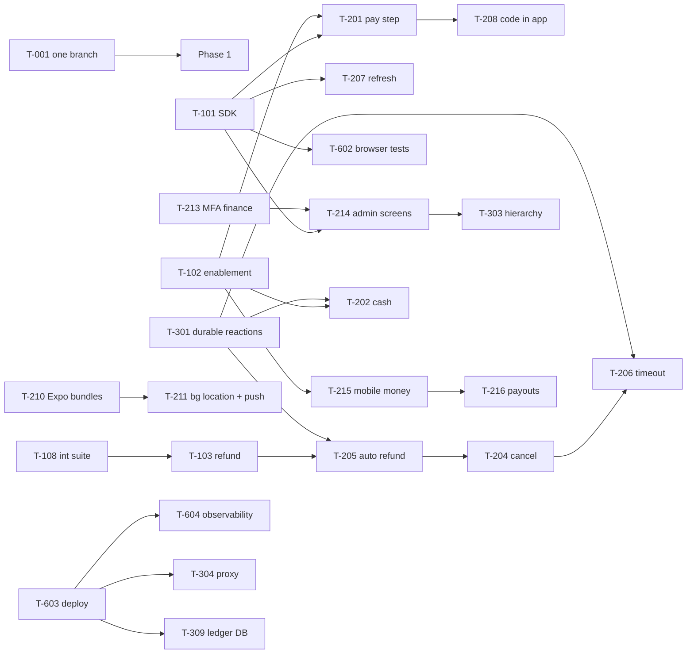

# Roadmap and priority order

The order in which to do the work in [`BACKLOG.md`](BACKLOG.md), and why. Tasks are ordered by what
they unblock and what they protect, not by how visible or easy they are.

## The logic of the order

1. **One line of code first.** Three branches hold different fixes. Nothing else is safe to start
   until they are one (Phase 0).
2. **Stop the bleeding.** Defects that make the product unusable, give goods away, or expose it:
   Phase 1. These are small, mostly independent, and several already exist on a branch.
3. **Then make a real order possible** for a real person, start to finish, including the ways an
   order goes wrong (Phase 2). Three business decisions gate this phase — take them during Phase 1.
4. **Then make it trustworthy** under failure and attack (Phase 3). Some items are pulled earlier
   where a Phase 2 feature would otherwise be built on sand (see "Pull-forwards").
5. **Then pay down structure** (Phase 4), **polish** (Phase 5), and **prove and ship** (Phase 6).
   Testing tasks T-601/T-602 are listed in Phase 6 by theme but should start as soon as Phase 1 ends.

## Phase 0 — Integration line

| Order | Task                                        | Why first                                             |
| ----- | ------------------------------------------- | ----------------------------------------------------- |
| 1     | T-001 Choose how the branches come together | Every later task depends on which code it starts from |

## Phase 1 — Critical bugs and blockers

Do these in this order. Items marked ⇄ exist on a remote branch: merge rather than rewrite.

| Order | Task                                     | Finding       | Unblocks                                 |
| ----- | ---------------------------------------- | ------------- | ---------------------------------------- |
| 1     | T-101 SDK `fetch` binding ⇄              | SDK-01        | Every browser journey; all UI testing    |
| 2     | T-108 Runnable integration suite ⇄       | TEST-01       | Safe changes to payments, T-103, T-105   |
| 3     | T-102 Payment enablement                 | PAY-01        | Any exposure of the API outside a laptop |
| 4     | T-103 Refund arithmetic                  | PAY-03        | T-205, support operations                |
| 5     | T-107 Webhook signature first ⇄          | PAY-05        | T-215                                    |
| 6     | T-104 Secret validation                  | SEC-01        | Any deployment                           |
| 7     | T-110 `infra:up`                         | OPS-01        | New contributors, CI parity              |
| 8     | T-106 Expo out of the default build      | MOB-01, CI-01 | T-109                                    |
| 9     | T-105 Dependency upgrades (`next` first) | DEP-01        | T-109, any deployment                    |
| 10    | T-109 Green CI                           | CI-01         | Enforceable quality gate                 |

_(updated 2026-11-12, sync S-004)_ T-105: the `next` step is done on pull request #3, not yet
merged. Fastify/Nest, `zod`, the Expo tool chain and `postcss` remain.

**Exit criteria:** the three web apps log in from a browser; CI is green; no known way to order for
free; a refund works; the API refuses to start with placeholder secrets.

## Phase 2 — Core functionality and incomplete workflows

Grouped by the journey they complete. Within a group, top to bottom.

**A. A customer can pay** — T-201 payment step → T-202 cash on delivery 🔒 → T-203 real OTP 🔒 →
T-209 minimum order → T-215 mobile money 🔒

**B. An order can go wrong safely** — T-205 automatic refund and reversal 🔒 → T-204 cancellation →
T-206 confirmation timeout

**C. A delivery can happen** — T-210 Expo apps bundle ⇄ → T-212 restaurant coordinates →
T-208 delivery code in customer apps → T-211 background location and push

**D. People stay logged in and can be managed** — T-207 token refresh ⇄ → T-213 MFA for finance →
T-214 admin console screens → T-217 history and profile

**E. Partners get paid** — T-216 payouts 🔒

🔒 = blocked on a decision or an external party; see [`BLOCKED_TASKS.md`](BLOCKED_TASKS.md).

**Exit criteria:** with test accounts and a real handset, a customer orders and pays cash, the
restaurant accepts on its console, a courier delivers with the app, and each failure path
(rejection, timeout, cancellation, failed delivery) ends with the customer's money returned.

### Pull-forwards from Phase 3

Do these _inside_ Phase 2, not after it:

| Task                              | Do it before             | Because                                                                           |
| --------------------------------- | ------------------------ | --------------------------------------------------------------------------------- |
| T-301 Durable reactions           | T-202, T-205, T-206      | Cash settlement, refunds and timeouts all hang on the same fire-and-forget events |
| T-302 Production bootstrap        | First shared environment | The only seed creates a super_admin on a public phone number                      |
| T-310 Readiness and error mapping | T-603                    | A deployment needs a truthful health check                                        |

## Phase 3 — Security, reliability and data integrity

| Order | Task                                          | Finding        |
| ----- | --------------------------------------------- | -------------- |
| 1     | T-301 Durable business reactions              | ARCH-01        |
| 2     | T-302 Production bootstrap                    | SEC-02         |
| 3     | T-303 Staff hierarchy guard                   | ADM-02         |
| 4     | T-305 OTP verification throttle               | SEC-03         |
| 5     | T-304 Trusted proxy → T-306 Global rate limit | SEC-04, SEC-06 |
| 6     | T-308 Session liveness and fresh roles        | SEC-08         |
| 7     | T-307 Token storage and CSP                   | SEC-05         |
| 8     | T-309 Ledger rules in the database            | SEC-07         |
| 9     | T-310 Readiness and error mapping             | OPS-03, API-01 |
| 10    | T-311 Delivery override and atomic pickup     | DLV-02, DLV-03 |
| 11    | T-312 Who may create restaurants              | ORD-04         |

**Exit criteria:** fault-injection tests pass for every cross-module reaction; an external
penetration test finds no high-severity issue.

## Phase 4 — Architecture and code quality

T-401 single dispatch implementation → T-402 jobs, retention, heartbeat → T-405 schema hygiene →
T-406 idempotency details → T-404 dead configuration → T-403 split large services (last, once T-601 is the safety net).

## Phase 5 — UI/UX and performance

T-502 notifications → T-503 uploads → T-504 pricing → T-501 polish → T-505 translations → T-506 accessibility and performance audit.

## Phase 6 — Testing, deployment and production readiness

| Order | Task                                 | Start                   |
| ----- | ------------------------------------ | ----------------------- |
| 1     | T-601 SQL-level integration tests    | Right after Phase 1     |
| 2     | T-602 Browser end-to-end tests       | Right after T-101       |
| 3     | T-605 Worker integration tests in CI | With T-601              |
| 4     | T-603 Deployment stack 🔒            | When hosting is decided |
| 5     | T-604 Observability                  | With T-603              |
| 6     | T-606 Realtime with two instances    | After T-603             |
| 7     | T-607 Documentation cleanup          | Any time                |

**Exit criteria for production:** staging deployed from the runbook; a restore drill done; alerts
fire on a stopped worker and on a ledger violation; the end-to-end suites run on every change.

## Dependency sketch

Last updated: 2026-11-11 (evidence collected 2026-11-10)
